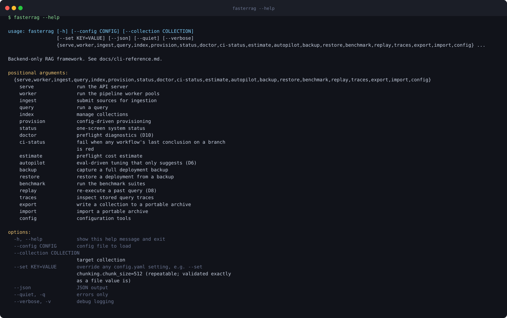
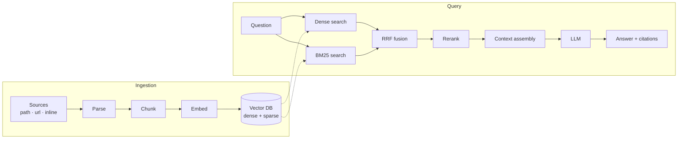

<div align="center">

<picture>
  <source media="(prefers-color-scheme: dark)" srcset="https://raw.githubusercontent.com/balrajsingh165/FasterRag/main/docs/assets/logo-banner-dark.svg">
  
</picture>

### A backend-only, all-in-one RAG framework for FastAPI

Ingest documents, retrieve with hybrid search, and answer with citations —<br>
through a REST API, a CLI, or a Python package, all driven by one config file.

[](https://github.com/balrajsingh165/FasterRag/actions/workflows/ci.yml)
[](LICENSE)
[](pyproject.toml)
[](docs/release-readiness.md)
[](pyproject.toml)
[](https://github.com/astral-sh/ruff)

[**Documentation**](https://docs-fasterrag.fortiqo.xyz/) ·
[**Quickstart**](docs/quickstart.md) ·
[**Configuration**](docs/config-reference.md) ·
[**REST API**](docs/api-reference.md) ·
[**CLI**](docs/cli-reference.md) ·
[**Changelog**](docs/CHANGELOG.md)

</div>

---

> [!IMPORTANT]
> **Status: pre-beta, not yet on PyPI — install from source.** The code is real and tested, but
> nothing has been released, and no performance figure in this repository is citable yet. This
> project's standing rule is that **a claim without a measurement is a bug**, so this page tells
> you what works, what is partial, what is not built — and
> [how to check each of those yourself](#dont-trust-us--check).

## Contents

- [What is fasterRag?](#what-is-fasterrag)
- [Features](#features)
- [Quickstart](#quickstart)
- [Don't trust us — check](#dont-trust-us--check)
- [How it works](#how-it-works)
- [Integrations](#integrations)
- [Configuration](#configuration)
- [Documentation](#documentation)
- [Project status](#project-status)
- [Development](#development)
- [Contributing](#contributing)
- [License](#license)

## What is fasterRag?

Most RAG stacks ask you to assemble parsing, chunking, embedding, retrieval, reranking,
caching, evaluation and observability by hand. fasterRag packages that pipeline as one backend
service with typed errors and an evaluation harness built in, and puts every vendor behind an
adapter so the vector database, embedding model and LLM provider are configuration, not code.

You can use it three ways, all backed by the same service layer and the same `config.yaml`:

| Surface | How | For |
|---|---|---|
| **CLI** | `fasterrag ingest / query / doctor / estimate / benchmark / replay …` | Operations, scripting, CI |
| **REST API** | `fasterrag serve` → `/v1/ingest`, `/v1/query` (SSE streaming) | Services and non-Python clients |
| **Python package** | `from fasterrag import FasterRag` (async) or `from fasterrag.sync import FasterRag` | Embedding RAG in your own application |

There is deliberately **no control GUI**. An optional, self-hosted dashboard exists for
observability only and has no write endpoint
([ADR-0005](docs/adr/ADR-0005-api-cli-only-control-plane.md)).

<div align="center">
  
</div>

## Features

**Ingestion**

- Parsers for PDF (with an optional OCR fallback for scanned pages), DOCX, HTML, Markdown,
  plain text, CSV/TSV and JSON
- Fixed, recursive, layout-aware and late chunking in the pipeline, plus a semantic chunker
  available as a standalone component
- Optional contextual enrichment of chunks before embedding
- Idempotent ingestion jobs with content-hash deduplication and a dead-letter queue
- `path`, `url` and `inline` sources, with SSRF-guarded URL fetching and allowlisted source roots

**Retrieval and generation**

- Hybrid retrieval: dense vectors and BM25 sparse vectors searched together and fused with
  Reciprocal Rank Fusion (k=60)
- Optional cross-encoder reranking
- Metadata filters pushed down to both retrieval legs
- Answers streamed over Server-Sent Events with source citations
- An optional grounded-or-refuse mode that grades faithfulness and refuses rather than answering
  without evidence

**Operations**

- API-key authentication with scopes, per-key rate limiting, and RFC 9457
  `application/problem+json` errors with stable machine-readable codes
- `fasterrag doctor` preflight checks, each failure printed with its fix
- `fasterrag estimate` for token counts and projected embedding cost before ingesting, and
  token budgets enforced at runtime
- Blue/green re-embedding behind a collection alias, with rollback
- A stored-trace `replay` command that re-runs a past query under a candidate configuration
- OpenTelemetry trace and metric export, Prometheus metrics, and optional Langfuse and Grafana
  provisioning
- An optional semantic cache with memory, disk or Redis storage

**Quality tooling**

- A retrieval evaluation harness (recall@k, MRR, nDCG, plus an LLM-graded faithfulness score)
  and a regression gate that compares a build against a committed baseline
- A benchmark ledger that every performance statement must link to
  ([docs/benchmarks.md](docs/benchmarks.md))

## Quickstart

**Requirements:** Python 3.12+, and Docker if you want fasterRag to start Qdrant for you. The
local profile below needs neither Docker nor an API key. CI tests Python 3.12 and 3.13 on Linux and 3.12 on
Windows; macOS is not tested.

### 1. Install from source

```bash
git clone https://github.com/balrajsingh165/FasterRag.git
cd FasterRag
pip install -e ".[all]"        # or pick extras: ".[server,qdrant,pdf,docx,html,openai]"
cp .env.example .env           # then fill in the keys your config.yaml references
```

The core install is the library and CLI with Markdown, text, CSV and JSON parsing. The web
server, the Qdrant client and the PDF, DOCX and HTML parsers are the extras `server`, `qdrant`,
`pdf`, `docx` and `html`; a missing one is named in the error you get.

**No service, no key:** `pip install -e ".[chroma,huggingface]"`, then
`fasterrag config init --profile local` writes a configuration with embedded Chroma, local
embeddings and keyless Ollama, and `fasterrag ingest note.md` works straight away.

### 2. Use the CLI

```bash
fasterrag doctor                 # preflight: Docker, ports, disk, keys
fasterrag provision qdrant       # start a managed Qdrant container
fasterrag estimate ./my-docs/    # token counts and projected embedding cost
fasterrag ingest ./my-docs/      # parse, chunk, embed and index a folder
fasterrag query "What does the vendor agreement say about termination?"
```

### 3. Or use Python

```python
import asyncio

from fasterrag import FasterRag


async def main() -> None:
    async with FasterRag.from_config("config.yaml") as rag:
        job = await rag.ingest(["./my-docs/"], recursive=True)
        print(job.status, job.counts)

        result = await rag.query("What does the vendor agreement say about termination?")
        print(result.answer)
        for citation in result.citations:
            print(citation)


asyncio.run(main())
```

`ingest` returns once the job has settled, and a document counts as indexed only after every
one of its chunks is in the vector database. A blocking twin with the same methods lives at
`fasterrag.sync`, and `rag.retrieve(...)` returns ranked chunks without calling an LLM.

### 4. Or run the REST service

```bash
fasterrag serve                  # API on :8000

curl -s http://localhost:8000/v1/ingest \
  -H "Content-Type: application/json" \
  -d '{"sources": [{"type": "path", "value": "/data/docs/vendor-agreement.pdf"}]}'

curl -s http://localhost:8000/v1/query \
  -H "Content-Type: application/json" \
  -d '{"query": "What does the vendor agreement say about termination?", "stream": false}'
```

> [!WARNING]
> Authentication is **off by default** so a local first run needs no keys — which is why the
> server binds to `127.0.0.1` by default. Turn on `security.auth` and set
> `ingestion.allowed_source_roots` before you bind it to any other address; `fasterrag serve`
> warns you if you do not. See [docs/security.md](docs/security.md).

The full walkthrough is in [docs/quickstart.md](docs/quickstart.md).

## Don't trust us — check

Most projects ask you to believe the README. This one is built so you do not have to: the
statements below are each backed by something you can run from a checkout in a few minutes.

| We say | Run this to check |
|---|---|
| The code is fully typed and lint-clean | `ruff check . && mypy` |
| The unit tier passes | `pytest -m "not integration and not eval and not load and not soak"` |
| A document is never recorded as indexed before it is in the index | `pytest tests/unit/workers/test_ledger.py` |
| A failed ingest can be retried and is not silently skipped | `pytest tests/unit/services/test_ingestion.py -k remembered_as_indexed` |
| One bad file costs one document, not the job | `pytest tests/unit/workers/test_cpu_pool.py -k untyped_parser` |
| Every vector-database adapter obeys the same contract | `pytest -m integration` (needs Docker) |
| A cached answer is never served for a different collection or filter | `pytest tests/unit/core/cache/test_semantic.py -k scope` |
| The dashboard cannot change anything | `pytest tests/unit/observability/test_dashboard.py -k write_route` |
| The REST API matches its reference page | `python scripts/check_openapi_drift.py` |
| No document claims a capability the code lacks, or denies one it has | `python scripts/check_claims.py && python scripts/check_unbuilt_claims.py` |
| No performance or superiority claim is made without a measurement | `pytest tests/unit/docs/test_superlative_scan.py` |
| No exception is silently swallowed | `python scripts/check_error_taxonomy.py` |

What we **cannot** show you yet is just as specific, and is written down with the same care:
the [engineering scorecard](docs/engineering-scorecard.md) records an independent audit of the
whole codebase — 47/100 when it was taken on 2026-11-11, 52 after the fixes made the same day —
together with the rubric it used, what a 90 would require in each category, and the open task
for every finding.

## How it works



- **Routers hold no business logic.** REST, CLI and the Python facade all call the same
  service layer, so behaviour and errors are identical on every surface.
- **Adapters isolate vendors.** Vector databases, embedding providers and LLM providers each
  sit behind an interface and a factory; vendor types do not leak past the adapter.
- **CPU work stays off the event loop.** Documents are parsed and chunked concurrently in a
  process pool and stream through a bounded queue into batched embedding workers.
- **"Indexed" is a statement about the index.** A ledger commits a document to the journal only
  when every chunk of it has been written, so a failure leaves nothing falsely recorded.
- **Configuration is validated up front.** `config.yaml` is checked in full at load, and every
  violation is reported at once.

More detail: [docs/architecture.md](docs/architecture.md) · [docs/flow.md](docs/flow.md) ·
[docs/internals.md](docs/internals.md).

## Integrations

| Layer | Supported |
|---|---|
| **Vector databases** | Qdrant (reference adapter), pgvector, Chroma (embedded), Milvus, Weaviate |
| **Embedding providers** | OpenAI, Cohere, Hugging Face (local, via sentence-transformers), Ollama |
| **LLM providers** | OpenAI, Anthropic, Cohere, Ollama, and any OpenAI-compatible endpoint |
| **Reranking** | Local cross-encoder models |
| **Caches** | In-memory, disk, Redis |
| **Observability** | OpenTelemetry (OTLP), Prometheus metrics, Langfuse, Grafana |

All five vector-database adapters share one contract test suite. The Pinecone adapter is
pending (TASK-0049) and is refused at config load rather than silently accepted. Details and
per-provider configuration: [docs/integrations.md](docs/integrations.md).

## Configuration

Everything is driven by two files: `config.yaml` holds all behaviour and is safe to commit, and
`.env` holds secrets only, referenced from the YAML by environment-variable name.

```yaml
vector_db:
  provider: qdrant          # qdrant | pgvector | chroma | milvus | weaviate

embeddings:
  provider: huggingface     # openai | cohere | huggingface | ollama
  model: BAAI/bge-small-en-v1.5

chunking:
  strategy: recursive
  chunk_size: 768
  overlap: 64

retrieval:
  hybrid: true
  rerank: true
  top_k: 5

llm:
  provider: openai          # openai | anthropic | cohere | ollama | openai_compatible
```

Any key can be overridden for one command with `--set`, for example
`fasterrag --set retrieval.top_k=10 query "…"`. Every key, its type, default and validation
rule is listed in [docs/config-reference.md](docs/config-reference.md), and ready-made setups
(local and air-gapped, cost-optimised, multi-tenant, …) are in
[docs/cookbook.md](docs/cookbook.md).

## Documentation

The documentation site at **<https://docs-fasterrag.fortiqo.xyz/>** is the short user guide,
built from [`userdocs/`](userdocs/). The complete reference and engineering documents are in
[`docs/`](docs/).

| Start here | Reference | Operating it | Evidence |
|---|---|---|---|
| [Quickstart](docs/quickstart.md) | [REST API](docs/api-reference.md) | [Deployment](docs/deployment.md) | [Benchmark ledger](docs/benchmarks.md) |
| [Using fasterRag](docs/how-to-use.md) | [CLI](docs/cli-reference.md) | [Security](docs/security.md) | [Testing strategy](docs/testing-strategy.md) |
| [Cookbook](docs/cookbook.md) | [Configuration](docs/config-reference.md) | [Reliability](docs/reliability.md) | [Release readiness](docs/release-readiness.md) |
| [Migration guide](docs/migration-guide.md) | [Python package](docs/python-api.md) | [Observability](docs/observability.md) | [Verification](docs/verification.md) |
| [Troubleshooting](docs/troubleshooting.md) | [Data model](docs/data-model.md) | [Failure modes](docs/failure-modes.md) | [Engineering scorecard](docs/engineering-scorecard.md) |
| [Glossary](docs/glossary.md) | [Prompt contracts](docs/prompts.md) | [Disaster recovery](docs/disaster-recovery.md) | [Architecture](docs/architecture.md) |

Design decisions are recorded as ADRs in [docs/adr/](docs/adr/), and the twelve capabilities
the project is built around are specified, each with an acceptance test, in
[docs/differentiators.md](docs/differentiators.md).

## Project status

fasterRag is in its build phase. Release confidence is re-derived at each release decision and
published whatever it says, in [docs/release-readiness.md](docs/release-readiness.md); the
engineering audit and the path from here are in
[docs/engineering-scorecard.md](docs/engineering-scorecard.md); the single task ledger is
[docs/todo.md](docs/todo.md).

| Working | Partial | Not yet |
|---|---|---|
| Config loader · CLI · REST API · Python facade (async and sync) · parsing and chunking · ingestion with dedup and a dead-letter queue · hybrid retrieval with RRF · cross-encoder rerank · SSE generation with citations · Qdrant, pgvector, Chroma, Milvus and Weaviate adapters · API-key auth with scopes · rate limiting · circuit breaker · evaluation harness and regression gate · `doctor` · cost estimator · trace store and replay · blue/green re-embedding · OTLP export · read-only dashboard · Docker image and compose profiles | Degradation ladder (`hybrid_only` and `extractive` served; the `cache_only` rung is specified but not built — TASK-0159) · the Milvus and Weaviate contract suites, which pass against real servers on a developer machine but run in no CI job, so nothing re-proves them on a change (TASK-0412) · portability export/import, in progress (TASK-0079) · multi-tenancy, with the caveats recorded in [docs/security.md](docs/security.md) · evaluation datasets, which are small · semantic chunking, which is available as a standalone component and refused by the ingestion pipeline (TASK-0431) | A separate ingestion worker process; ingestion runs inside the process that accepts the job (TASK-0130) · Pinecone adapter (TASK-0049) · PyPI publication (TASK-0087) · citable benchmarks — the [ledger](docs/benchmarks.md) holds only non-citable entries until the isolated-hardware baseline run |

Its goal is to be the fastest, most efficient, and most reliable RAG framework available. That
is a goal, not a result: no measurement in this repository yet supports a speed claim, and none
is made.

## Development

```bash
uv sync --locked --extra dev --python 3.12   # install exactly uv.lock
pre-commit install                           # pre-commit and commit-msg hooks

ruff check . && ruff format --check .        # lint and format
mypy src/                                    # strict type check
pytest -m "not integration and not eval and not load and not soak"   # what CI gates on
pytest -m integration                        # adapter contract suites against real backends
pytest -m eval                               # retrieval evaluation harness
```

The unit tier holds over 4,000 tests (measured 2026-11-11), and CI additionally runs
packaging, secret-scanning, dependency-audit and documentation-truth gates. See
[docs/testing-strategy.md](docs/testing-strategy.md).

## Contributing

Contributions are welcome. Please read [docs/CONTRIBUTING.md](docs/CONTRIBUTING.md) first — a
few rules are enforced by CI and will surprise you otherwise:

- **Conventional Commits, single line**, no body and no trailers
- **Docstrings only** — no inline or explanatory comments beyond `# CRITICAL:`, `# TODO:` and
  `# BLOCKED:` markers
- **One task file** — [docs/todo.md](docs/todo.md) is the only ledger
- **No unmeasured claims** — a performance or superiority statement must link to the benchmark
  ledger or be written as a goal

## License

Apache-2.0 — see [LICENSE](LICENSE) and [NOTICE](NOTICE). The decision and its reasoning are
recorded in [ADR-0008](docs/adr/ADR-0008-apache-2-license.md).
