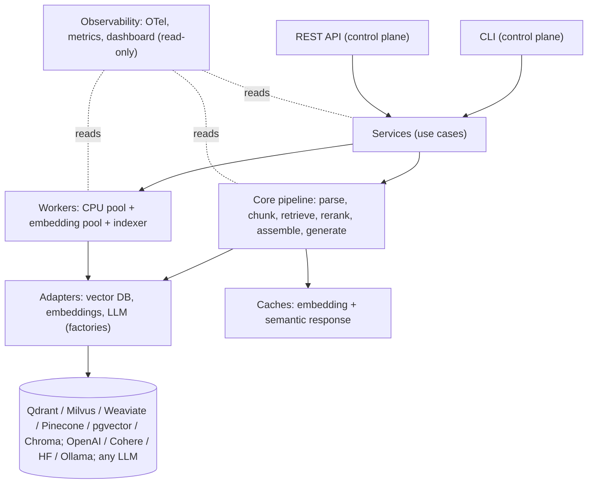

# architecture.md — Component Architecture

How fasterRag achieves its speed, quality, and pluggability goals. Flows in [flow.md](flow.md); layout in [structure.md](structure.md); every parameter in [config-reference.md](config-reference.md).

## 1. Component overview



The dashboard and all observability components are strictly read-only consumers of pipeline events — nothing in the pipeline depends on them, and they expose no control endpoints.

## 2. Multi-worker parallelism

The ingestion pipeline is **decoupled** into two pools connected by a bounded queue:

- **CPU worker pool** — loading, parsing, and chunking are CPU-bound; N processes (default: CPU count) consume the ingest queue.
- **GPU/embedding worker pool** — embedding generation is accelerator/provider-bound; M workers consume the chunk queue.

Design rules:

- **Streaming hand-off.** Chunks stream from the CPU pool to the embedding pool as they are produced, so expensive embedding workers never idle waiting on parsing.
- **Stateful embedding workers.** Each embedding worker loads the embedding model into memory **once per worker** and reuses it across all batches. Reloading a model per task is a large avoidable cost — a local model takes seconds to load against milliseconds of retrieval — and is prohibited by design. The size of that gap on reference hardware is unmeasured (TASK-0084).
- **Fault tolerance from decoupling.** Because stages communicate only via a queue, a failed embedding batch is retried without re-parsing its document, and a failed index write is retried without re-embedding it. A document that raises while parsing — including an exception a parser library did not type — costs that document only. A worker *process* dying is different and is stated plainly: the standard library marks the whole pool broken, so the job fails with a typed error, where an earlier revision of this page said it would lose only the in-flight item.
- **"Indexed" is decided by the index side.** `workers/ledger.py` registers each parsed document with its chunk count; the embedding pool reports every chunk it wrote or gave up on; the journal records the document as indexed, and remembers its content hash, only when every chunk is in the vector database. Until 2026-11-11 this was recorded when the chunks were merely enqueued, so a document that failed downstream was both dead-lettered and remembered as indexed, and a retry skipped it (TASK-0427).
- **Documents are parsed concurrently.** Up to `workers.cpu_pool_size` documents are in the process pool at once and are consumed in submission order. Earlier revisions awaited each document before submitting the next, which keeps one worker busy whatever the pool size. The throughput effect of the change is unmeasured (TASK-0454).
- **A parse has a deadline.** `ingestion.parse_timeout_seconds` bounds each document's time in the pool. A running process-pool task cannot be cancelled, so an overdue document costs its pool rather than only its future: the workers are killed, a new pool is started, the documents in flight beside it are submitted again, and the overdue one alone is dead-lettered as `PARSE_TIMEOUT`. The deadline runs from submission, so before any document is submitted, at start and after a recycle, the pool starts as many workers as the documents will occupy; a pool that spawns starts its workers on demand, which used to bill every worker's start-up but the first to a document's deadline. What a recycle, and that start-up, cost in throughput is unmeasured.
- **The two halves fail together.** A dead consumer would leave the producer blocked on a full queue and a dead producer would leave consumers waiting for a close that never comes, so whichever stops first ends the job, which is then settled `failed`.
- **What this section does not yet provide.** There is no queue backend and no separate worker process: both pools run inside the process that accepted the job — `fasterrag serve`, `fasterrag ingest` or the Python facade (TASK-0130). The `fasterrag worker` command, which only checked the vector database and waited, was removed on 2026-11-12. A job that process was running when it exited is settled, and resumed only on request (§12).
- **Backpressure.** The chunk queue is bounded (`workers.queue_depth`). If embedding lags, CPU workers block on enqueue rather than filling memory; if a remote embedding provider throttles, the queue absorbs the burst instead of hammering the rate limit.

## 3. Batching

- **Embedding**: per-document batched embedding amortizes per-request overhead that one-at-a-time calls pay per text — requests are aggregated to `embeddings.batch_size` texts. The saving is unmeasured (TASK-0084). Async batch embedding with queued workers prevents pipeline stalls and provider rate-limit throttling. A batch the provider refuses for its size is halved and re-sent, so only an input that cannot fit on its own fails, and a `Retry-After` on a rate limit is waited out up to `reliability.retries.backoff_max_ms` (TASK-0478).
- **LLM inference**: provider calls are batched where the provider supports it; concurrent generation requests share connection pools.
- **Indexing**: vector upserts go to the adapter in batches, amortizing network round-trips.

## 4. Async FastAPI

- All I/O-bound endpoints are `async`. The API process performs no CPU-heavy work.
- **Queue-based decoupling of ingestion**: `POST /v1/ingest` validates, persists a job record, enqueues, and returns `202 Accepted` with a `job_id` — the API accepts ingestion asynchronously without blocking on parsing/embedding/indexing.
- Generation responses stream (SSE) so time-to-first-token is decoupled from total generation time.
- **A filesystem-backed store offloads its own blocking calls, rather than asking each caller to remember** (TASK-0357, TASK-0399). `Journal`, `FileIdempotencyStore` and the semantic-cache store each expose an `async` method over a synchronous body they run in a worker thread; a coroutine therefore cannot stall the loop on them by forgetting a rule, and `tests/unit/test_no_blocking_journal_in_async.py` fails the build if one tries. Stores that still have synchronous callers outside the API — `LockStore`, `TraceStore`, the archive reader and writer — have not been converted and are listed as open work in [todo.md](todo.md).

## 5. Configurable chunking pipeline

Selected via `chunking.strategy` (see [config-reference.md](config-reference.md)):

| Strategy | Description |
|---|---|
| `fixed` | Fixed-size token windows with overlap. Baseline; requires no model inference. |
| `recursive` | Recursive/hierarchical splitting on structural separators (sections → paragraphs → sentences) down to target size. |
| `semantic` | Split at semantic-similarity boundaries between adjacent sentences/passages, then re-split any group the token counter puts above `chunk_size`, as `recursive` does. Sentence vectors come from the configured embedding model, which each CPU worker process loads for itself — once, before the first document, so a model load is never billed to a parse deadline — and which must therefore be local (`embeddings.provider: huggingface`); any other provider is refused when the job is accepted. Memory is `workers.cpu_pool_size` copies of the model. |
| `layout` | Layout/document-structure-aware: respects headings, tables, lists, and reading order from the parser. |
| `late` | Late chunking: embed the whole document first, then derive each chunk's embedding by pooling the token representations inside its span. Boundaries are identical to `recursive`; only the vectors change, so a chunk saying "It was raised from 35 pounds" carries what "it" refers to instead of losing it at the boundary. Needs token-level output, which only a **local** embedding model exposes — on a hosted provider the pipeline logs the reason and falls back to ordinary per-chunk embedding, making the strategy no better than `recursive` rather than broken. Documents longer than the model's context are processed in overlapping windows, each token taking its representation from the window that gave it the most surrounding context; the strategy is most valuable with a long-context embedding model where a document fits in one pass. |
| contextual enrichment (`chunking.contextual_enrichment`, composable with any strategy) | Contextual-retrieval-style enrichment: prepend a short document-level context to each chunk **before** embedding and BM25 indexing. |

**Sizing guidance.** `chunking.chunk_size` defaults to **768 tokens**. That default and the 64–2500 bounds are configurable engineering choices, **not** measured optima — tune them against your own corpus with the eval harness ([testing-strategy.md](testing-strategy.md)). The rationale for the shipped values: a chunk longer than the embedding model's maximum sequence length is silently truncated at embed time, so the default is kept modest and the warning above 1024 exists to prompt a check of `chunk_size` against the sequence limit of the configured model; the 2500 ceiling is a guardrail against pathological values. The **"context cliff" near ~2,500 tokens** reported in [references.md](references.md) R3 is a limit on the **total retrieved context** handed to the generator, not a ceiling on chunk size — and R3 is a single January 2026 preprint on one setup whose authors note the drop-off point is model-dependent. The earlier "~512–1024 practical working range" attributed to that source has been withdrawn: the study swept chunk sizes of 50–500 only and recommends 150–300 (TASK-0247).

**Contextual Retrieval evidence.** Per Anthropic's September 2024 engineering post *"Contextual Retrieval in AI Systems"*, Contextual Embeddings + Contextual BM25 **reduce failed retrievals by 49%**, and **by 67% when combined with reranking** — cutting the top-20-chunk retrieval failure rate from **5.7% to 1.9%**. Quote: *"This method can reduce the number of failed retrievals by 49% and, when combined with reranking, by 67%."* fasterRag's implementation follows the post's cost guidance: keep generated per-chunk context short (**~50–100 tokens**, `chunking.context_tokens`) and use **prompt caching of the parent document** so the context-generation LLM re-reads the document from cache rather than re-billing full input tokens per chunk.

## 6. Hybrid search + reranking

The retrieval stack, in order:

1. **Dense leg** — ANN search over the vector index, top `retrieval.rerank_top_n` candidates.
2. **Sparse leg** — **BM25** keyword search over the same corpus, same candidate count. Both legs run in parallel and receive pushed-down metadata filters.
3. **Fusion** — **Reciprocal Rank Fusion with k=60**, the value recommended in the original 2009 SIGIR paper by Gordon V. Cormack, Charles L. A. Clarke, and Stefan Büttcher, *"Reciprocal Rank Fusion outperforms Condorcet and individual Rank Learning Methods,"* shown robust across TREC/LETOR benchmarks. `RRF(d) = Σ 1/(k + rank_i(d))`.
4. **Reranking** — a **cross-encoder reranker** scores the fused top candidates (retrieve top 100–1000 → rerank → truncate to `top_k`).

Design rationale (**not measurements** — no ledger entry isolates either stage, so neither statement may be quoted as a number or a ranking; see [benchmarks.md](benchmarks.md) and TASK-0084):

- Reranking adds latency to every query, growing with `retrieval.rerank_top_n` and the size of the cross-encoder. The "~100–300 ms" figure earlier revisions of this document quoted had no source and has been withdrawn. BENCH-0003 (2026-11-03) priced the stage for the first time; the numbers are **not citable** — non-isolated, CPU-only — but they are the right order of magnitude to plan against: 12.9 s p50 for the shipped `BAAI/bge-reranker-v2-m3` over a 12-candidate shortlist and 86.9 s at the shipped `rerank_top_n: 100`, against 0.65 s and 5.18 s for `ms-marco-MiniLM-L-6-v2`. No GPU was measured. Measure it on your own hardware with `fasterrag benchmark`.
- Reranking and the sparse leg are the two levers this stack expects to matter most for retrieval quality, because dense search misses exact identifiers and rare terms that BM25 catches, and a cross-encoder sees the query and the passage together where a bi-encoder cannot. That is the reasoning behind offering both, not a measured ranking of upgrades; the sparse leg ships on and the reranker ships off, because its cost is measured and its benefit is not yet ([ADR-0010](adr/ADR-0010-reranker-off-by-default.md)).

## 7. Caching

| Cache | Keyed by | Notes |
|---|---|---|
| **Embedding cache** | provider + model + model version + configured dimensions + input type (document or query) + content hash of the text | Skips re-embedding identical chunks/queries; enabled by default (`embeddings.cache.enabled`). It wraps every embedding adapter where the embedding router is composed (`services/embedding_router.py`, re-exported by the composition root `services/composition.py`), which is the router the API, the CLI, the facade and the ingestion service all build, so re-ingesting an unchanged corpus with dedup off sends nothing to the provider. A batch costs one cache read and one cache write whatever its size. Vectors from late chunking (`chunking.strategy: late` on a local model) are never cached, because they depend on the whole document and not on the chunk's text. The `disk` backend keeps its entries in `.fasterrag/cache/embedding/`, apart from a disk-backed semantic cache, which is cleared on every ingest. |
| **Semantic response cache** | embedding similarity of the query (cosine threshold, typically **~0.92–0.97**) | A sufficiently similar previous query returns its cached answer without touching the pipeline. |
| **Provider prompt caching** | provider-side | Used for contextual-enrichment (parent doc) and long shared prompts. |

Invalidation is **TTL + event-driven**: entries expire after `cache.ttl`, and corpus changes (ingest, delete, re-index) invalidate affected entries immediately — stale answers must never outlive the data they came from. **Cache hit/miss counters are first-class metrics** exposed to the dashboard and Grafana.

## 8. Streaming responses

Generation streams token-by-token over SSE. Time-to-first-token matters more than total latency for perceived speed; context assembly and generation are pipelined so the first token is emitted as soon as the provider produces it.

## 9. Incremental updates

- **Deduplication** — content hashes computed at ingestion; an identical document is skipped, and a changed one is re-chunked under deterministic chunk ids, so re-ingesting it overwrites its chunks instead of duplicating them. A document the journal already holds is an **update**: once every chunk of the new version is written, the chunks at or beyond its new length are deleted by a `document_id` + `chunk_index` filter (`workers/indexer.py::Indexer.trim`), and the hash of the version it replaced stops counting as a duplicate, so restoring an earlier version re-indexes it. A known document that now parses to nothing is recorded `skipped` and retired the same way — every chunk trimmed, its dedup record tombstoned. A document is **deleted** by `services/documents.py` — its chunks by a `document_id` filter, its dedup record by a tombstone in the journal, its lockfile entry and the semantic cache — over REST, the CLI and both facades. *Limits (2026-11-12): the trim needs the journal's record, so with `ingestion.dedup: false` a shrunken document still leaves its tail; and chunks written under a different chunker configuration have different ids at every index, which only `index reembed` or a delete removes.*
- **Chunk metadata** — every chunk records its source URI, content hash, position, chunker strategy, and embedding model and version. *Status (2026-11-12): a document version and an ingestion timestamp are not stored (`workers/indexer.py::chunk_payload`); neither is built (TASK-0524).*
- **Re-embedding** — when the configured embedding model differs from the indexed one, the system flags drift and offers a guided `index reembed` (build a parallel collection, then atomically swap) to fight embedding drift and stale indexes.

## 10. Pluggability: adapter + factory patterns

### VectorDBAdapter

Abstract base interface with the standard methods:

```python
class VectorDBAdapter(ABC):
    """Vendor-neutral vector database contract."""

    async def create_collection(self, spec: CollectionSpec) -> None: ...
    async def upsert(self, points: list[Point]) -> UpsertResult: ...
    async def search(self, query: SearchQuery) -> list[ScoredPoint]: ...
    async def update(self, updates: list[PointUpdate]) -> None: ...
    async def delete(self, selector: PointSelector) -> None: ...
    async def health(self) -> HealthStatus: ...
```

Each request type additionally carries an optional **sparse vector**, because the BM25 leg lives inside the collection rather than in a separate index ([ADR-0007](adr/ADR-0007-bm25-as-backend-sparse-vectors.md)): `CollectionSpec.sparse` creates the keyword index, `Point.sparse` writes term frequencies alongside the dense vector, and `SearchQuery.sparse` runs the keyword leg. A `SearchQuery` carries exactly one leg — hybrid retrieval runs both and fuses the rankings in fasterRag, so `retrieval.rrf_k` is the constant that actually applies rather than whatever a backend's built-in fusion hard-codes.

A **factory** reads `vector_db.provider` and instantiates the concrete adapter. **Qdrant is the reference implementation**; **pgvector** ships alongside it — a deliberately opposite (SQL) paradigm — and **Chroma** (embedded, file-backed, shipped 2026-11-03) alongside both. Three implementations of three different shapes pass the same contract suite against a running store, which is what makes the vendor-neutral contract evidence rather than intent. **Milvus** (2026-11-07) and **Weaviate** (2026-11-08) are built and registered in the factory, but their contract subclasses have never been run against a server — every case skips without a daemon ([integrations.md](integrations.md)), so they are shipped code and not yet evidence. **Pinecone alone is specified but not built** (TASK-0049); the configuration schema refuses it by name at load, citing that task, rather than accepting the setting and failing later in the factory — which is what happened until 2026-11-12, when `pinecone` was still a member of the schema's closed provider list. A single `vector_db.provider` change swaps between the shipped backends with **no application-code changes**. Rationale in [ADR-0001](adr/ADR-0001-qdrant-as-reference-vector-db.md) and [ADR-0002](adr/ADR-0002-adapter-factory-pluggability.md).

### Qdrant specifics

- **Modes**: (a) **system-managed Docker** — fasterRag launches and manages the container; (b) **no-Docker** — the user runs Qdrant themselves and fasterRag connects to it; (c) **remote** — connection via `host:port`/IP when Qdrant runs on another machine.
- **Ports/protocols**: per Qdrant's official Python client docs, `QdrantClient` defaults are `port=6333` (REST) and `grpc_port=6334` (gRPC); `prefer_grpc` defaults to `False`. **Both 6333 and 6334 must be exposed** — Qdrant GitHub Discussion #2195 records connection failures when only 6333 is exposed and the client attempts gRPC.
- **Persistence**: mount a storage volume. On **Windows/WSL use a named Docker volume** — bind mounts have known file-system data-loss issues per Qdrant's install docs.
- **Security**: authenticated access via `QDRANT__SERVICE__API_KEY`; the key itself lives in `.env`, referenced from config by env-var name.

### Embedding and LLM factories

Same pattern: `embeddings.provider` and `llm.provider` select concrete adapters (OpenAI, Cohere, HuggingFace/sentence-transformers, Ollama/local for embeddings; any LLM provider). Each adapter names the exact client it was written against — the Cohere generator builds `cohere.AsyncClientV2`, the Ollama adapters read the typed responses `ollama` 0.4 introduced — and the Cohere and Ollama ones are replayed against the real client libraries in the unit tier ([integrations.md](integrations.md) §3b). A `TypeError` or `AttributeError` raised while an LLM adapter drives its client is a non-retryable `INTERNAL` error, not an outage: it means the installed library and the adapter disagree, and retrying or failing over cannot fix that. **Tiered embedding** routes document classes to different models — cheap models for high-volume/low-priority classes, higher-cost models where retrieval precision matters.

### Third-party providers

Each of the three factories also resolves a name registered under its entry-point group — `fasterrag.vectordb`, `fasterrag.embeddings`, `fasterrag.llm` — so a provider shipped as a separate package is selected by the same one-line `provider:` change as a built-in, with no edit to this repository. Two rules keep that safe. **A built-in name always wins**, in the factory and in validation alike, so an installed package cannot take over `qdrant` and intercept a deployment's vectors. **Validation stays fail-fast and stays inside `config/`**: `config/plugins.py` accepts a name that is built in or that an installed distribution registers, reading entry-point metadata through `importlib.metadata` and importing nothing — `config/` never imports `adapters/`, because every adapter imports the schema. Any other name stops the load with an error listing the built-in names and the installed plugins. The built-in names therefore exist twice, once as each factory's `_BUILTIN_ADAPTERS` and once as plain strings in `config/plugins.py`; `tests/unit/config/test_provider_names.py` fails when they disagree. `tests/unit/test_plugin_selection.py` installs a fake distribution, loads a `config.yaml` naming it through the real loader, ingests a document and answers a query through adapters no factory names. The plugin contract is in [python-api.md](python-api.md).

### Config-driven dynamism

- `config.yaml` drives ALL behavior; `.env` holds ONLY soft credentials/secrets ([ADR-0003](adr/ADR-0003-config-yaml-env-split.md)).
- Loader: **pydantic-settings** with a YAML source for config and env/`.env` for secrets. Validation runs at startup and **fails fast** with a clear error naming the offending key. This decouples application logic from the config source and enforces 12-factor separation of config and credentials.
- **Every integration option defaults to `false`.** Flipping e.g. `langfuse: true` causes the system to read config, **auto-install**, perform **all required configuration** on the user's system, and return a **running URL** — with the strict rule that **no code changes are made at that moment** (pure config-driven provisioning). The provisioning path is idempotent and converges to the desired state, reusing cached images rather than re-pulling them. The same pattern applies to `grafana` and similar tools. Details in [observability.md](observability.md).

## 11. Scaling patterns

- **Vertical**: raise `workers.cpu_pool_size` / `workers.embedding_pool_size` to saturate cores/GPUs; bounded queues keep memory flat.
- **Horizontal (beta)**: API replicas behind a load balancer, each running the ingestion jobs it accepts. Worker processes that attach to a shared queue backend, so ingestion scales apart from the API, are not built (TASK-0130). Replicas are not yet stateless either: rate limits, token budgets, circuit breakers and the file journal are per process (TASK-0437, TASK-0426).
- **Vector DB**: sharding/replication configured per collection through the adapter (`collection.shard_number`, `collection.replication_factor` for Qdrant); remote mode moves the DB to dedicated hardware.
- **Streaming ingestion**: no stage ever materializes an entire corpus in memory — documents flow through queues in bounded batches, which is what makes very large datasets feasible.

## 12. Fault tolerance

- Stage decoupling (Section 2): failures retry at the failing stage only, and a job is always settled — an exception of any kind leaves it `failed`, never `running`.
- **Cancellation settles a job too** (TASK-0436). `asyncio.CancelledError` is not an `Exception`, so until 2026-11-12 a cancelled job settled nothing and both halves of its pipeline kept running unawaited. A cancelled job now stops the parse side and the embedding side, waits for a checkpoint write already in its worker thread, and is then settled `failed` with `reason_code: INTERRUPTED` on top of the last checkpoint. One limit is stated plainly: leaving the CPU pool calls `executor.shutdown(wait=True)`, so the settle waits for the documents already being parsed, and a single very slow parse delays it by that long.
- **Shutdown drains, and startup reaps** (TASK-0436). The API keeps every running job in a registry (`services/jobs.py`). On shutdown it stops starting jobs, waits `reliability.shutdown_grace_seconds`, cancels what remains, and closes its adapters only after every job has settled. A cancelled job's parse pool kills its workers instead of joining them, so a parser that never returns cannot hold the drain past the grace period (TASK-0525). A process that is killed outright runs none of that, so the next one to start looks for `running` jobs that have been quiet for `reliability.stale_job_seconds` — and `queued` ones, which a process killed between the `202` and the job's task starting leaves with nothing to run them (TASK-0526) — and settles them `failed` / `INTERRUPTED`; it looks a second time one window later, because an orphan left seconds before the restart is not yet stale on the first look. Jobs are settled, not resumed, at startup. Running one again is always a request — `fasterrag ingest --resume <job_id>`, or a replay of its `idempotency_key` body field — and that run starts at `Journal.resume_index` rather than at the first document.
- Circuit breakers are process-wide (`core/breaker.py::shared_breaker`), one per provider, because the REST API builds its services per request and a breaker owned by a per-request object can never count past one. The reranker model is cached per process for the same reason. So is the LLM adapter: the API builds it on the first query, keeps it on `app.state.llm`, lends it to each request's `GenerationService` and closes it once at shutdown, where it used to build a provider client per query and close it when the answer was sent (TASK-0466). The services stay per request because `GenerationService` carries the caller's tenant and the query in flight; the services are assembled by `services/composition.py`, which the CLI and the facade call too.
- Bounded retries with exponential backoff per queue item; poisoned items park in a dead-letter state on the job record for inspection.
- Idempotent indexing: upserts keyed by deterministic chunk IDs, so replays never duplicate.
- Health/readiness endpoints (`/healthz`, `/readyz`) gate traffic; adapters implement `health()` so a sick backend is visible before queries fail.
- Fail-fast config validation prevents a misconfigured process from ever serving.

## 13. Pain-point coverage

Every pain point in the [scope.md](scope.md) catalogue maps to a mechanism in this document: chunking quality (§5), retrieval accuracy (§6), grounding/citations (§6, §9 metadata), stale indexes and incremental updates (§9), messy PDFs (parser stage, §2), metadata filtering (§6 push-down), hybrid + reranking (§6), evaluation ([testing-strategy.md](testing-strategy.md)), cost (§3, §7), latency (§4, §7, §8), very large datasets (§2, §11), multi-tenancy and security ([security.md](security.md)), observability (§1, [observability.md](observability.md)), vendor lock-in (§10), context-window management (§5 sizing + context assembly budgeter), embedding drift (§9), cold-start (§10 provisioning), retrieval-vs-generation debugging (per-stage traces, [observability.md](observability.md)).
