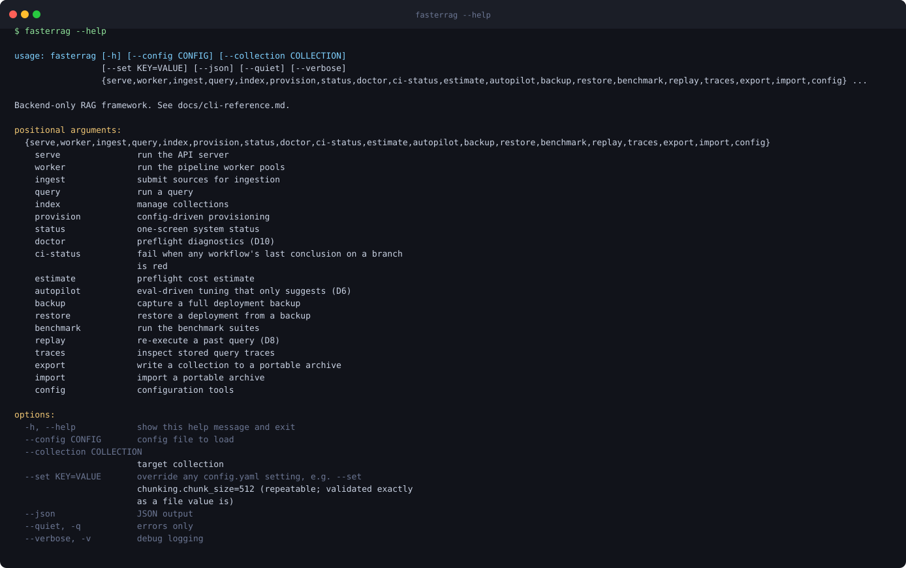
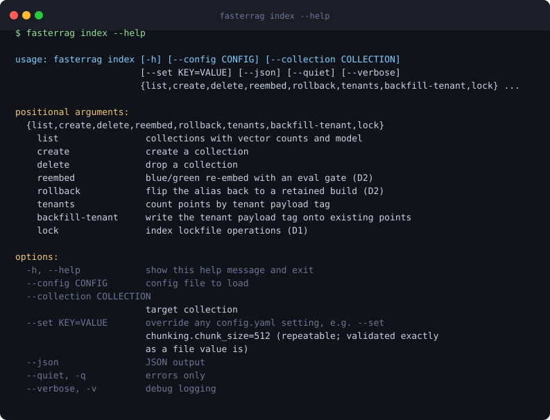
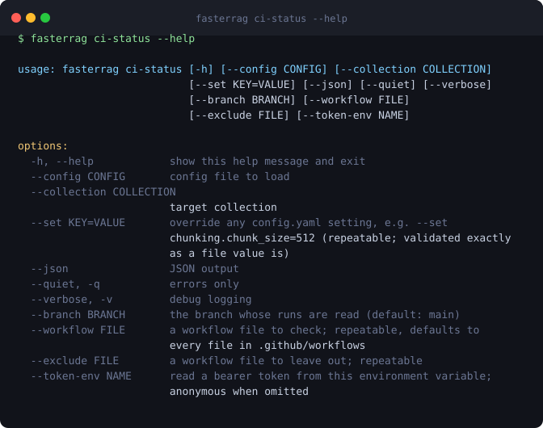

# fasterRag

**A backend-only Retrieval-Augmented Generation framework, operated entirely through a REST API
and a terminal.** Built on FastAPI and Pydantic v2, with every vendor behind an adapter so the
vector database, embedding model and LLM provider are configuration rather than code.

[Read the quickstart](quickstart.md){ .md-button .md-button--primary }
[View on GitHub](https://github.com/balrajsingh165/fasterrag){ .md-button }

---

## What it is

fasterRag ingests documents, chunks them through a configurable pipeline, embeds and indexes
them, then answers questions over them with citations. It is designed to run as part of your
own infrastructure — self-hosted, no control-plane GUI, no vendor lock-in at any layer.

<figure markdown>
  
  <figcaption>Real output from <code>fasterrag --help</code>, generated from a captured run.</figcaption>
</figure>

## What makes it different

**Everything is pluggable through configuration.** Qdrant is the reference vector database;
pgvector, Chroma, Milvus and Weaviate are registered alongside it, selected by a single
`config.yaml` key. The same is true of embedding and LLM providers. No application code changes
when you switch.

**Hybrid retrieval by default.** Dense vectors and BM25 sparse vectors are searched together and
fused, with optional cross-encoder reranking. Both legs receive the same pushed-down filter, so
they always search the same subset of the corpus.

**Blue/green re-embedding.** Changing an embedding model builds a new collection behind an alias
and flips only when an eval gate passes, so a model change cannot silently degrade retrieval.

**A typed error taxonomy, enforced.** No bare `except`, no silently swallowed exception. API
errors are RFC 9457 `application/problem+json` with a stable machine-readable code. A CI gate
parses the source tree and fails the build on a handler that hides a failure.

**Claims are gated, not asserted.** Every performance statement in this documentation is either
a goal or it links to an entry in the [benchmark ledger](benchmarks.md). A CI gate greps for
superlatives and fails on any that do not.

<figure markdown>
  
  <figcaption>Collection management, including multi-tenant payload tooling.</figcaption>
</figure>

## Honest status

This is a **beta in its build phase**, and the documentation is deliberately candid about what
that means:

- The [benchmark ledger](benchmarks.md) holds six entries and **marks all six non-citable**,
  because they were measured on non-isolated hardware. The project targets high ingestion and
  retrieval throughput; it does not yet claim it, and the ledger explains exactly why.
- [Release readiness](release-readiness.md) is re-derived at each release decision and published
  whatever it says.
- [Failure modes](failure-modes.md) is a full FMEA table, and [reliability](reliability.md)
  documents the error taxonomy and its enforcement.
- The [verification procedure](verification.md) is a tiered acceptance process for proving a
  checkout matches these documents.

If you are evaluating this project, those four pages will tell you more than any feature list.

## Where to start

| You want to | Read |
| --- | --- |
| Run a query end to end | [Quickstart](quickstart.md) |
| Understand the moving parts | [Architecture](architecture.md) |
| Configure it for your stack | [Configuration reference](cookbook.md) |
| Call it over HTTP | [REST API reference](api-reference.md) |
| Drive it from a terminal | [CLI reference](cli-reference.md) |
| Import it as a library | [Python package surface](python-api.md) |
| Move from another framework | [Migration guide](migration-guide.md) |
| Deploy and operate it | [Deployment](deployment.md) and [Security](security.md) |

## Operational tooling

The CLI covers the whole lifecycle, not just querying: provisioning, preflight diagnostics, cost
estimation, portable export and import, trace inspection and query replay, backup and restore,
and a continuous-integration status check.

<figure markdown>
  
  <figcaption>A workflow that is green on push can be red on a schedule; this reads every one.</figcaption>
</figure>

## Licence and source

Apache-2.0. The source, the issue tracker and the full commit history are at
[github.com/balrajsingh165/fasterrag](https://github.com/balrajsingh165/fasterrag).
Contributions are welcome — [CONTRIBUTING](CONTRIBUTING.md) sets out the rules, which are
stricter than most and exist for reasons the [decision records](adr/ADR-0001-qdrant-as-reference-vector-db.md)
explain.
